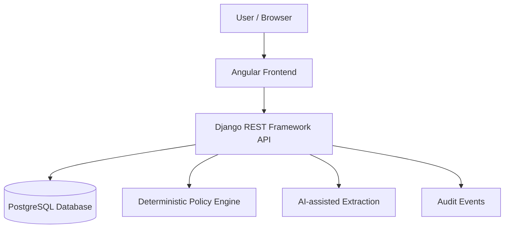

# PayBlood

**Deterministic invoice policy engine with AI-assisted invoice extraction.**

PayBlood is a multi-organization accounts-payable platform designed to register invoices, manage vendors, extract structured information from invoice documents, and evaluate invoices against explicit, versioned business policies.

The system separates data extraction from financial decision-making: **AI assists with extracting invoice information, while a deterministic policy engine evaluates the applicable rules. The application does not execute payments.**

## Live demonstration

- **Application:** https://payblood.netlify.app
- **Login:** https://payblood.netlify.app/login
- **Backend:** https://payblood-production.up.railway.app
- **Demo organization:** `Demostracion 30X`

The application is deployed on Netlify, with the Django backend and PostgreSQL database hosted on Railway. Availability of individual endpoints and features depends on their authentication and authorization requirements.

## Demo accounts

The following credentials are intended exclusively for the public demonstration environment. Anyone who can access this README can use them while the accounts remain active. Do not use these accounts for real financial information.

| Role | Email | Password |
|---|---|---|
| `FINANCE_ADMIN` | `financeadmin@payblood.demo` | `mMXto1LVVqC2kdHO` |
| `OPERATOR` | `operator@payblood.demo` | `MlfUAw0gTpNowHSw` |
| `APPROVER` | `approver@payblood.demo` | `ZslDgGNT0kQ48JET` |
| `AUDITOR` | `auditor@payblood.demo` | `aAXM7IIEZhlejlxp` |

**Important:** these credentials have been supplied for documentation, but their current production status and permissions must be confirmed against the live application before this README is published. The `FINANCE_ADMIN` membership in particular requires explicit verification because the backend intentionally restricts role delegation.

The existing global superadmin account is separate from these four accounts. Its password and authentication tokens must never be published in this README.

### Suggested evaluation scenarios

1. Sign in with each account and inspect its identity and active memberships.
2. Explore the vendors and invoices visible to the current organization member.
3. Verify that `FINANCE_ADMIN` can access permitted administrative operations.
4. Verify that `OPERATOR` can register invoices but cannot perform finance-administrator-only operations.
5. Verify the actual approval-related permissions assigned to `APPROVER`; do not assume that the role has an approval workflow unless it is implemented.
6. Verify that `AUDITOR` can access permitted read operations without acquiring write privileges.
7. Confirm that a user cannot access data belonging to another organization.

Only mark a scenario as verified after testing it against the deployed application.

## Architecture




### Technology stack

| Layer | Technology |
|---|---|
| Frontend | Angular, TypeScript |
| Backend | Python, Django, Django REST Framework |
| Database | PostgreSQL in production; SQLite configured for local development |
| Authentication | JWT-based authentication as reported for the deployed environment; confirm the current implementation |
| Frontend hosting | Netlify |
| Backend hosting | Railway |
| Production server | Gunicorn |
| API documentation and contracts | `docs/implementation-contract.md` |

The exact installed versions should be taken from the current dependency lockfiles and requirements files rather than assumed from earlier development reports.

## Features

### Organization and access management

- Organization-scoped access to application resources.
- User accounts and organization memberships.
- Role-based permissions enforced by the backend.
- Account and membership activation and deactivation.
- Security-relevant audit events.

Global administrator privileges and organization-level roles are different. A `FINANCE_ADMIN` membership does not automatically grant global superadmin privileges.

### Vendor management

- Organization-scoped vendor records.
- Vendor creation and updates.
- Explicit activation and deactivation.
- Preservation of inactive vendor records.
- Organization-level uniqueness of normalized tax identifiers.
- Auditing of supported vendor mutations.

### Invoice management

- Invoice registration and retrieval.
- Association with a vendor belonging to the same organization.
- Monetary values represented with decimal precision.
- Supported currency validation.
- Issue-date and due-date validation.
- Controlled initial invoice status.
- Transactional audit events for invoice creation.

Invoice registration is separate from policy evaluation. Registering an invoice does not execute a payment.

### Policy engine

The policy engine evaluates invoices using versioned policy configurations and deterministic rules.

The documented decision outcomes are:

- `approved`: the invoice satisfies the applicable rules; this is a simulated decision, not a payment.
- `blocked`: a mandatory policy rule is violated.
- `escalated`: human review is required or the system cannot safely decide.

The documented precedence is `blocked → escalated → approved`. An invoice without an applicable active policy must not be automatically approved.

Policy versions and decision records are designed to preserve the rules and rationale used at evaluation time. Confirm the current implementation and tests before relying on these guarantees in production.

### AI-assisted invoice extraction

The project documentation describes a flow for uploading invoice documents, extracting structured fields, validating those fields, reviewing the extracted information and creating an invoice.

The extraction provider, supported file types, size limits, verification adapter and frontend flow must be checked against the current code before being considered production-ready. AI extraction is an input-assistance feature, not the authority that decides invoice approval.

### Audit trail

The backend documents audit events for relevant account, membership, vendor, invoice and policy operations. Transactional operations are intended to roll back if their corresponding audit event cannot be persisted.

Application-level restrictions do not necessarily provide database-level immutability. The actual guarantees depend on the implemented models, transactions, admin configuration and database.

## Roles and permissions

The following table summarizes the intended separation of duties. Confirm every permission against the current backend before treating it as an exhaustive access-control specification.

| Role | Intended access |
|---|---|
| Global superadmin | Global administration privileges according to the configured Django permissions |
| `FINANCE_ADMIN` | Organization administration and permitted vendor, invoice and policy operations |
| `OPERATOR` | Operational access, including invoice registration where authorized |
| `APPROVER` | Approval-related permissions only where an approval workflow is implemented |
| `AUDITOR` | Read and audit-related access according to the configured permissions |

Access is evaluated on the server. Frontend route guards and hidden buttons are not substitutes for backend authorization.

Organization access is intended to require an active user, an active membership and an active organization. A user's membership in one organization must not grant access to another.

## Authentication

The deployed environment has been reported to use JWT access and refresh tokens, including an `HttpOnly` refresh cookie.

The backend documentation also describes these authentication operations:

| Method | Documented route | Purpose |
|---|---|---|
| `POST` | `/api/v1/auth/login/` | Authenticate with email and password |
| `POST` | `/api/v1/auth/refresh/` | Renew access credentials |
| `GET` | `/api/v1/auth/me/` | Retrieve the authenticated user's profile and active memberships |
| `POST` | `/api/v1/auth/logout/` | End the session and revoke or invalidate the relevant refresh credential according to the implementation |
| `POST` | `/api/v1/auth/set-password/` | Set an initial password using a one-time setup token |

**Route verification required:** the deployed configuration has also been described using `/auth/login/`, `/auth/refresh/`, `/auth/me/` and `/auth/logout/`. Confirm whether the public base URL includes `/api/v1` before publishing these paths as final.

The actual authentication configuration determines token expiry, rotation, revocation, session behavior, cookie attributes and CSRF requirements. Do not assume that all previously documented settings are still current.

Never place real tokens, cookies, passwords, signing keys or database credentials in frontend source code or public documentation.

## API overview

The backend documentation describes the following organization-scoped route families. Confirm the exact prefixes and permissions in the current URL configuration.

| Resource | Operations documented |
|---|---|
| Organizations | List accessible organizations and retrieve an authorized organization |
| Memberships | List, create, update and deactivate memberships where authorized |
| Users | Create accounts and manage activation through administrative operations |
| Vendors | List, retrieve, create, update, activate and deactivate |
| Invoices | List, retrieve, register and evaluate against a policy |
| Policies | List policy versions and create a new version where authorized |
| Decisions | Retrieve the persisted result of an invoice evaluation |
| Extraction | Submit an invoice document for structured extraction, if the current implementation supports it |

Unauthorized organization access should not disclose whether another organization's resources exist. The precise HTTP status codes and exceptions should be confirmed against the actual permission classes and tests.

## Local development

### Requirements

- Python version supported by the current backend dependency set.
- Node.js and npm versions compatible with the current frontend.
- Git.
- SQLite for the configured local database, or a separately configured PostgreSQL instance.

Check the pinned dependency files before selecting runtime versions.

### Backend

From the repository root:

```bash
cd backend
python -m venv .venv
```

Activate the environment.

Windows PowerShell:

```powershell
.venv\Scripts\Activate.ps1
```

macOS/Linux:

```bash
source .venv/bin/activate
```

Install the development dependencies:

```bash
pip install -r requirements/dev.txt
```

Configure the required local environment variables using your local, untracked environment configuration. Generate a development-only Django secret key instead of reusing a production secret.

Run local migrations and start Django:

```bash
python manage.py migrate
python manage.py runserver
```

The default development server is normally available at `http://127.0.0.1:8000/`, unless the project's current configuration specifies another address.

### Frontend

Open a separate terminal:

```bash
cd frontend
npm ci
npm start
```

Use the frontend environment configuration to point the application to the appropriate local API. Never put secrets or private credentials into Angular environment files because frontend build values are publicly accessible to browser users.

The development frontend is typically served at `http://localhost:4200/` if that is the configured development port.

## Environment configuration

Configure secrets locally or through the hosting provider's environment-variable settings. Do not commit `.env` files, production secrets, database backups or credential files.

The following variable names are documented in the project and must be checked against the actual settings code:

| Variable | Purpose |
|---|---|
| `DJANGO_SECRET_KEY` | Django signing and cryptographic configuration |
| `DJANGO_DEBUG` | Enable or disable Django debug mode |
| `DJANGO_ALLOWED_HOSTS` | Allowed HTTP hostnames |
| `DATABASE_URL` | Database connection configuration |
| `DJANGO_CORS_ALLOWED_ORIGINS` | Browser origins allowed to access the API |
| `AI_PROVIDER` | Select the configured extraction provider |
| `AI_MODEL` | Configure the extraction model |
| `AI_API_KEY` | Provider credential, if required |

Production secrets must be configured in Railway and must never be copied into the README.

**Repository hygiene:** do not add `.env.example` to the repository. If local configuration guidance is needed, document the required variable names and purposes here without exposing values.

## Running tests

### Backend

```bash
cd backend
python manage.py check
python manage.py makemigrations --check --dry-run
python manage.py test
```

Use an isolated test database. Do not run test setup against production or reset a development database to obtain a passing result.

### Frontend

```bash
cd frontend
npm test
npm run build
```

The available scripts must be confirmed against `frontend/package.json`.

Only publish test totals after running the current suites and recording their actual results. Historical test counts are not proof that the current code passes.

## Production deployment

The reported production architecture uses:

- **Netlify:** Angular frontend.
- **Railway:** Django backend and PostgreSQL database.
- **Gunicorn:** WSGI application server.

Production configuration should use HTTPS, restricted allowed hosts, explicit CORS origins and secure cookie settings appropriate for the actual frontend/backend domain relationship.

Before considering a release complete, verify:

1. The frontend points to the production API rather than localhost.
2. Login, profile retrieval, token refresh and logout work.
3. Organization isolation and role permissions behave correctly.
4. Database migrations are consistent with the deployed code.
5. Logs do not contain passwords, tokens or other secrets.
6. The deployed application uses the intended production database.

Do not apply migrations or change production configuration as part of documentation-only work.

## Current scope and limitations

The project documentation describes organization management, membership administration, vendors, invoices, policy evaluation, authentication and AI-assisted extraction. The exact completion status of each module must be established from the current code and tests.

The following limitations have been documented and should be rechecked before publication:

- No actual payment execution.
- AI extraction does not make the final policy decision.
- The human approval workflow may be incomplete or separate from deterministic evaluation.
- Password recovery and public registration may be outside the current scope.
- Audit-event immutability may be enforced at the application level rather than directly by the database.
- PostgreSQL concurrency guarantees require validation against PostgreSQL, not only SQLite.
- Global superadmin privileges and organization-scoped roles must remain separate.
- Demo credentials are public if this README is published publicly and must never be reused for real accounts or real business data.

## Project documentation

The implementation contract is maintained in:

- [`docs/implementation-contract.md`](docs/implementation-contract.md)

Additional documentation, such as the extraction integration guide and the ODD specification, should be linked here if those files exist in the current repository.

## Security principles

- Never publish superadmin credentials, production secrets, tokens or private database connection strings.
- Keep public demo accounts isolated from real data and production administration.
- Do not rely on frontend-only permission checks.
- Preserve organization-level data isolation.
- Keep financial decisions deterministic, auditable and separate from AI extraction.
- Do not treat a simulated approval as authorization to execute a payment.